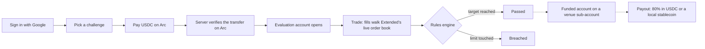
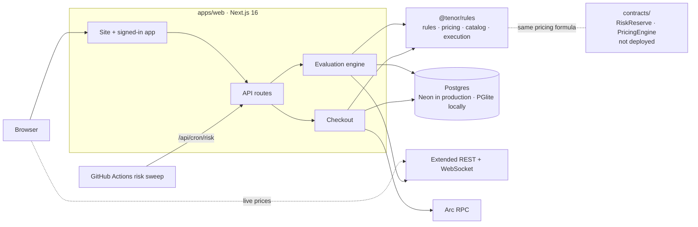

<div align="center">


# Tenor

**The prop firm that can't trade against you.**

100% A-book prop trading on [Arc](https://docs.arc.io), Circle's stablecoin L1. Traders pass a simulated evaluation priced from a real order book, then trade real capital on Arc venues. Every possible loss is pre-funded onchain, and payouts settle in the trader's own currency.

[](https://github.com/vishnudevs1/tenor/actions/workflows/ci.yml)


[Live app](https://tenor-tau-beryl.vercel.app) · [Transparency](https://tenor-tau-beryl.vercel.app/transparency) · [@Tenor_xyz](https://x.com/Tenor_xyz)

</div>

> [!IMPORTANT]
> Tenor runs on **Arc testnet**. Evaluations, checkout and the rules engine are live. Funded accounts, payouts and the onchain contracts are not deployed yet, and the transparency page shows **demo data** (badged in the UI). See [Project status](#project-status).

## Contents

- [Why Tenor](#why-tenor)
- [Project status](#project-status)
- [How it works](#how-it-works)
- [Architecture](#architecture)
- [Getting started](#getting-started)
- [Configuration](#configuration)
- [Scripts and tests](#scripts-and-tests)
- [Smart contracts](#smart-contracts)
- [API reference](#api-reference)
- [Deployment](#deployment)
- [Arc notes](#arc-notes)
- [Roadmap](#roadmap)
- [Security](#security)

## Why Tenor

Most retail prop firms keep funded trades in-house (a B-book), so the firm earns when its traders lose. Tenor is built on three promises, each meant to be enforced by code rather than marketing.

| Promise | How it is enforced | Where |
| --- | --- | --- |
| **No B-book.** Every funded trade is a real fill on edgeX, Extended or Hibachi. | Each funded account maps to a venue sub-account with a trade-only key. | `IFundedAccountManager` in [`contracts/src/interfaces/ITenor.sol`](contracts/src/interfaces/ITenor.sol) (interface only) |
| **Every loss is pre-funded.** | `RiskReserve.reserve()` reverts unless USDC held ≥ (live max loss + the new account's max loss) × 1.2. | [`contracts/src/RiskReserve.sol`](contracts/src/RiskReserve.sol) |
| **We only win when you win.** | After the one-time fee, income is a share of real profits. Traders keep 80%. Fees are priced so they cover the worst case without a B-book. | [`packages/rules/src/pricing.ts`](packages/rules/src/pricing.ts), [`contracts/src/PricingEngine.sol`](contracts/src/PricingEngine.sol) |

## Project status

| Area | Status |
| --- | --- |
| Landing page and transparency page | Live. Transparency uses demo data from [`apps/web/lib/data.ts`](apps/web/lib/data.ts) until the contracts are deployed. |
| Google sign-in (Auth.js) | Live |
| Challenge shop: 6 sizes × 3 plans × 1-step or 2-step, plus a free demo account | Live |
| Checkout: USDC on Arc, verified onchain by the server | Live on testnet |
| Evaluation engine: real order-book fills, TP/SL, daily rollover, breaches, 2-step phases | Live |
| Risk sweep (rules enforced while the app is closed) | Scheduled via GitHub Actions every 5 minutes, once `CRON_SECRET` and `TENOR_URL` are set |
| `RiskReserve` and `PricingEngine` contracts | Written and tested, **not deployed** |
| Funded accounts, venue sub-accounts, trade-only keys | Not built |
| Payouts and local-currency conversion (Circle StableFX) | Not built |
| KYC before funding | Not built |

## How it works

### Trader journey



Dashed steps are on the roadmap.

### Challenges and pricing

Fees are never hard-coded. They come from one self-pricing formula, shared by the UI, the server and the `PricingEngine` contract, and rounded **up** so a fee can never fall below the solvency line:

```text
fee = ceil( pass rate × account size × max drawdown × 1.25 gap buffer × 1.2 target coverage )

25K Classic, 1-step: 0.08 × 25,000 × 0.06 × 1.25 × 1.2 = $180
```

Seed pass rates are **8%** for 1-step and **5%** for 2-step ([`products.ts`](packages/rules/src/products.ts)), until the closed beta produces real ones.

| Plan | Profit target | Max drawdown (static) | Daily loss limit |
| --- | --- | --- | --- |
| Classic | 10% (2-step: 8% then 5%) | 6% | 3% |
| Turbo | 9% (2-step: 8% then 5%) | 3% | 3% |
| Pro | 12% (2-step: 8% then 5%) | 5% | 3% |

| Fee (USDC) | 5K | 10K | 25K | 50K | 100K | 200K |
| --- | ---: | ---: | ---: | ---: | ---: | ---: |
| Classic, 1-step | 36 | 72 | 180 | 360 | 720 | 1,440 |
| Turbo, 1-step | 18 | 36 | 90 | 180 | 360 | 720 |
| Pro, 1-step | 30 | 60 | 150 | 300 | 600 | 1,200 |
| Classic, 2-step | 23 | 45 | 113 | 225 | 450 | 900 |
| Turbo, 2-step | 12 | 23 | 57 | 113 | 225 | 450 |
| Pro, 2-step | 19 | 38 | 94 | 188 | 375 | 750 |

Every plan has an 80% profit split, no time limit and no consistency rule. A trader can hold up to 200K of active paid evaluations at once, and one free 10K demo account.

### Evaluation engine

The engine in [`apps/web/lib/server/engine.ts`](apps/web/lib/server/engine.ts) is server-authoritative: the client never computes fills or breaches.

- **Prices:** Extended's public API (mark, index, book, candles). The browser streams live prices straight from Extended's WebSocket for display only; fills and rule checks always use the server's own fresh read.
- **Fills:** market orders walk the venue's real order book (VWAP), plus a 0.05% taker fee. Orders larger than the visible book are rejected, and position caps are sized from live book depth.
- **Markets:** BTC, ETH, SOL, gold (XAU), EUR/USD and USD/JPY. Leverage is capped at 5×, and 3× for alts.
- **Hedging mode:** every order opens its own ticket with its own entry, P&L, TP and SL.
- **Rules:** enforced by `@tenor/rules` on every read, order and risk sweep, in this order: TP/SL, UTC daily rollover, breach (closes everything), pass (a 2-step account moves to phase 2). The same rules code is meant to run funded accounts, so the simulation and live trading can't disagree.
- **Staleness guard:** with prices older than 15 seconds, nothing is enforced and no orders fill, so bad data can't cause a breach.
- **Concurrency:** every read-modify-write locks the account row (`SELECT … FOR UPDATE`), so concurrent requests can't double-apply a fill or a breach.
- **Risk sweep:** `GET /api/cron/risk` checks every active account. Without it, rules are only enforced while the trader has the app open.

### Checkout on Arc

1. The cart is priced on the server. Client totals are never trusted.
2. The wallet signs an order message, which proves it owns the address.
3. The wallet sends a USDC `transfer` to the Tenor treasury.
4. The server checks the receipt on Arc: a USDC `Transfer` log from the signed wallet, to the treasury, for at least the total, after the order was created, with a transaction hash never used before.
5. Evaluation accounts open.

If the tab closes mid-payment, checkout offers **Verify now** on return. Orders expire after 2 hours.

## Architecture



```text
apps/web/                  Next.js 16 app (App Router, Tailwind CSS v4)
  app/(site)/              Public: landing, /transparency
  app/(app)/               Signed-in app (top nav; bottom tabs on mobile)
    dashboard/             Total equity, today's P&L, challenge cards (live)
    challenges/            Shop: Demo to 200K, 1/2-step, Classic/Turbo/Pro, cart
    checkout/              Pay USDC on Arc, server verifies onchain, accounts open
    trade/                 Chart, live order book, order form, positions, history
    payouts/               Payout status (funded accounts not live yet)
  app/api/                 JSON API (fixed paths, auth checked per route)
  app/login/               Google sign-in
  proxy.ts                 Redirects signed-out users away from the trader app
  lib/server/
    venue.ts               Extended market data: stats, order book, candles, trades
    engine.ts              Evaluation engine: fills, marking, TP/SL, breaches, phases
    checkout.ts            Order pricing and USDC payment verification on Arc
    db.ts                  Postgres via node-postgres (DATABASE_URL) or PGlite (local)
  lib/arc.ts               Arc chain config (chain IDs, RPC, USDC/EURC addresses)
  lib/markets.ts           Tradable markets and leverage caps
  lib/data.ts              Transparency DEMO data only (badged "Demo data" in the UI)
  test/                    Integration tests (live venue data + Arc testnet RPC)
packages/rules/            Shared and pure: rules, pricing, catalog, execution math (+ unit tests)
contracts/                 Solidity (Foundry): RiskReserve, PricingEngine, interfaces
.github/workflows/         CI (unit tests + typecheck) and the scheduled risk sweep
```

**Stack:** Next.js 16.4 · React 19.3 · TypeScript 5.7 · Tailwind CSS 4 · Auth.js v5 (Google) · viem 2 · Postgres (node-postgres / PGlite) · lightweight-charts 5 · Solidity 0.8.24 with Foundry · Node 22.

## Getting started

### Prerequisites

- Node.js **22.x** and npm
- A Google OAuth client (Web) from [Google Cloud Console](https://console.cloud.google.com/apis/credentials)
- A wallet you control for the treasury, and testnet USDC from the [Circle faucet](https://faucet.circle.com) to test checkout
- Optional: [Foundry](https://book.getfoundry.sh/) for the contracts

### Run locally

```bash
git clone https://github.com/vishnudevs1/tenor.git
cd tenor
npm install
cp apps/web/.env.example apps/web/.env.local   # then fill it in, see Configuration
npm run dev                                    # http://localhost:3000
```

1. In Google Cloud Console, add `http://localhost:3000/api/auth/callback/google` as an authorized redirect URI. Put the client ID and secret in `AUTH_GOOGLE_ID` and `AUTH_GOOGLE_SECRET`.
2. Set `TENOR_TREASURY_ADDRESS` to a wallet you control. USDC from checkout is sent there.
3. Generate `AUTH_SECRET` with `npx auth secret`.
4. Open [`/api/health`](http://localhost:3000/api/health). It reports which settings are present (never their values) and whether the database and the venue answer.

No database setup is needed locally: without `DATABASE_URL`, the app runs PGlite (Postgres compiled to WebAssembly) and stores data in `apps/web/.data`.

## Configuration

Set these in `apps/web/.env.local`. The core ones are templated in [`apps/web/.env.example`](apps/web/.env.example).

| Variable | Required | Description |
| --- | --- | --- |
| `NEXT_PUBLIC_ARC_NETWORK` | No | `testnet` (default) or `mainnet`. Keep `testnet` until the contracts are audited. |
| `AUTH_SECRET` | Recommended | Signs sessions. `NEXTAUTH_SECRET` also works. If neither is set, one is derived from the Google secret, so rotating that secret signs everyone out. |
| `AUTH_GOOGLE_ID` | Yes | Google OAuth client ID |
| `AUTH_GOOGLE_SECRET` | Yes | Google OAuth client secret |
| `TENOR_TREASURY_ADDRESS` | Yes, for checkout | Wallet that receives challenge fees in USDC on Arc |
| `CRON_SECRET` | Yes, in production | Bearer token that protects `/api/cron/risk` |
| `DATABASE_URL` | Yes, on Vercel | Postgres connection string (for example Neon). Without it, local dev and tests use PGlite. |
| `TENOR_DATA_DIR` | No | PGlite data directory. Default: `.data` in the app's working directory. |
| `EXTENDED_API_URL` | No | Override Extended's REST base URL |
| `NEXT_PUBLIC_EXTENDED_WS_URL` | No | Override Extended's WebSocket URL used by the browser |

## Scripts and tests

| Command | What it does |
| --- | --- |
| `npm run dev` | Start the web app at http://localhost:3000 |
| `npm run build` | Production build of the web app |
| `npm test` | Unit tests for `@tenor/rules`: rules, pricing, catalog, execution |
| `npm run typecheck -w @tenor/web` | Type-check the web app (CI runs the same check) |
| `npm run test:engine -w @tenor/web` | Engine and checkout integration tests against live Extended data and Arc testnet, on a throwaway database. Needs network access. |
| `cd contracts && forge install foundry-rs/forge-std --no-git && forge test` | Contract tests, including a fuzzed coverage invariant |

CI ([`.github/workflows/ci.yml`](.github/workflows/ci.yml)) runs `npm ci`, `npm test` and the typecheck on every push to `main` and on every pull request. It does not run the Foundry tests yet.

## Smart contracts

> [!WARNING]
> The contracts are unaudited and not deployed. Do not use them with real capital.

| Contract | Purpose |
| --- | --- |
| [`RiskReserve`](contracts/src/RiskReserve.sol) | A USDC vault. `reserve(accountId, maxLoss)` reverts unless assets ≥ (`liveMaxLoss` + `maxLoss`) × buffer (1.2× target). `release()` frees the reservation and pays any realized loss to the manager. `coverageRatio()` reports coverage in basis points. |
| [`PricingEngine`](contracts/src/PricingEngine.sol) | `minFee(size, maxDdBps)` mirrors `packages/rules/src/pricing.ts` and rounds up. An attestor updates the trailing pass rate with an evidence root. |
| [`ITenor.sol`](contracts/src/interfaces/ITenor.sol) | Interfaces for the full system: `IChallengeRegistry`, `IPricingEngine`, `IRiskReserve`, `IFundedAccountManager` (venue 0 edgeX, 1 Extended, 2 Hibachi), `IPayoutModule` |

The pricing formula lives in two places, `pricing.ts` and `PricingEngine.sol`. Keep them in sync: `test_pricingMatchesBlueprint` checks that the contract prices 25K Classic at $180.

## API reference

All routes live under `apps/web/app/api`. Routes marked **session** need a signed-in user.

| Route | Method | Auth | Purpose |
| --- | --- | --- | --- |
| `/api/markets` | GET | Public | Live stats for every market, with position caps |
| `/api/book?symbol=BTC-USD` | GET | Public | Top of the venue order book and recent trades |
| `/api/candles?symbol=BTC-USD&interval=5m` | GET | Public | OHLCV candles from the venue |
| `/api/health` | GET | Public | Which settings are present, plus database and venue checks |
| `/api/accounts` | GET | Session | The trader's accounts |
| `/api/account?id=…` | GET | Session | One account marked to market, with closed trades |
| `/api/accounts/demo` | POST | Session | Open the free demo account |
| `/api/orders` | POST | Session | Open a ticket: `{ accountId, market, side, notional, leverage?, tp?, sl? }` |
| `/api/orders/close` | POST | Session | Close a ticket, a fraction of it, or `"all"` |
| `/api/orders/update` | POST | Session | Set or clear TP/SL on a ticket |
| `/api/checkout` | POST | Session | Price the cart and open a pending order |
| `/api/checkout/confirm` | POST | Session | Verify the USDC transfer on Arc and open the accounts |
| `/api/cron/risk` | GET | `Bearer $CRON_SECRET` | Enforce rules on every active account |

## Deployment

The live app runs on Vercel with a hosted Postgres database such as Neon.

1. Import the repo into Vercel and set the variables from [Configuration](#configuration). `DATABASE_URL` is required: serverless file systems are read-only, so the app refuses to fall back to PGlite on Vercel.
2. Add `https://<your-domain>/api/auth/callback/google` as a redirect URI on the Google OAuth client.
3. Schedule the risk sweep. Vercel's Hobby plan only allows daily crons, so [`.github/workflows/risk-sweep.yml`](.github/workflows/risk-sweep.yml) calls the endpoint every 5 minutes instead. In the repo's Actions settings, add:
   - secret `CRON_SECRET`, the same value as in Vercel
   - variable `TENOR_URL`, for example `https://<your-app>.vercel.app`

## Arc notes

From [docs.arc.io](https://docs.arc.io):

- Testnet chain ID `5042002`, mainnet `5042`.
- USDC is the gas token. **Native balance has 18 decimals, the ERC-20 view has 6.** Everything here uses the ERC-20 view.
- Set `maxFeePerGas` ≥ 20 gwei, or transactions are silently dropped. Checkout enforces this.
- Finality is one block. Order events by block number, not timestamp.

## Roadmap

- **Funded accounts:** venue sub-accounts and trade-only keys on edgeX, Extended and Hibachi, plus `FundedAccountManager`.
- **Payouts:** `PayoutModule`, 80% to the trader in USDC, EURC or local stablecoins (BRLA, MXNB, JPYC, KRW1, QCAD, ZARU) through Circle StableFX.
- **Contracts on testnet:** deploy `RiskReserve` and `PricingEngine`, then switch `/transparency` from demo data to onchain reads.
- **Proof of state:** a daily Merkle root of all account states, published on Arc.
- **KYC** (Sumsub or Socure) before funding.
- Limit orders, analytics, competitions, leaderboard and points.

## Security

- The contracts are unaudited. The app stays on Arc testnet until they are audited.
- Secrets live only in `.env.local` or the hosting provider. `.env*` files are ignored by git, except `.env.example`.
- `/api/health` reports whether each setting is present, never its value.
- Payments are verified onchain against a signed order message, and each transaction hash can only be used once.

Found a vulnerability? Please report it privately to the maintainers rather than opening a public issue.
